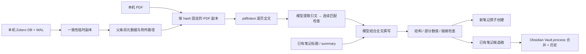

# 数据流与隐私

`paperflow_fetch.py` 不写原始 Zotero DB；复制 DB 和 WAL 前后检查时间戳等，再让 SQLite 在临时副本中读取。它依赖 Zotero 本地 schema，因此未来 Zotero 版本变化可能需要适配。群组文库和相对路径 linked-attachment base directory 不支持。

模型输入包括完整 PDF 提取文本、书目数据、模板，以及目标论文目录中已带 Zotero key 的笔记标题/summary。个人区域正文、其他笔记正文、Zotero 批注及子笔记不发送。模型请求经 `curl`；API key 从配置或环境读取，通过文件描述符传给 curl，不放进命令行参数。请求会到用户配置的模型服务，需遵守其数据政策。

`.paperflow/state/` 包含 PDF、全文、原文引文、模型输出和诊断；`.paperflow/history/` 包含旧笔记；`.paperflow/config.json` 可能含密钥。这些都是私人运行数据，不应提交到开源仓库。安装器不修改用户的同步配置；将 `PAPERFLOW_CONFIG` 指向知识库外，可减少把密钥同步出去的风险。桌面启动的 Obsidian 可能不继承 shell 环境变量，需要通过启动环境设置或自行配置。

Obsidian 和 skill 均调用 `paperflow_run.py`，按 key 的 job 锁贯穿提取、元数据读取和生成；底层阶段另有本地锁。候选稿使用唯一文件名，避免后续任务替换尚未合并的新稿。新笔记使用不可覆盖的原子创建；重生成只输出候选稿和 AI 前缀 hash，Obsidian 编辑器检查前缀未变后合并最新个人区。该机制不是跨电脑分布式锁，多设备同时生成仍可能冲突。底层 fetch/summarize 脚本供开发诊断，不要在默认流程运行时手工并行修改同一个 state 目录。

网络传输失败即停止，API单次模型请求最多240秒；原文证据和正文的校验失败各最多修正一次，不叠加额外传输重试。程序不再按数字偶合自动补引用页，引用数字检查不通过会要求模型修正或省略。

原文引文匹配和数值检查不能替代语义审查。数值出现在引用页面，不代表它一定属于正文声称的指标/实验条件；关系分析也可能把相似机制误作直接继承。默认状态要求人工精读，不声明已复现实验。

## 2.2 传输与格式

`codex-cli` transport 调用原生 `codex exec`，从基础 config.toml 读取公开的模型/provider 设置，不读取 auth.json 或复制令牌。不支持 profile 和自定义 URL/密钥 provider；不保留 CLI 请求日志。请求失败立即停止，超时取消进程组。API 请求仍走原 curl 路径。CLI 单次最多600秒，任务上限50分钟；证据/正文各最多一次校验修正。

CLI 仅允许已验证的 0.155.1 版本。临时模型能力目录保留服务端模型 slug，同时关闭 shell、patch、实验工具；额外关闭 web、plan、apps、hooks、子 agent、记忆等功能。`tests/test_codex_native.py` 使用空 CODEX_HOME 和本地 SSE 模拟服务，运行真实 CLI，断言出站请求 `tools=[]`；运行方式为 `PAPERFLOW_TEST_CODEX=1 PYTHONPATH=backend python -m unittest discover -s tests -v`。默认离线测试跳过这项原生版本验证，不调用真实模型。

原文出处由程序生成原生可折叠 callout，并在独立行放置块 ID。模型自测答案同样用 callout。写入前无损统一引用范围/编号，再检查 HTML、围栏、表格列数和引用；不更改数值与论断。写作要求集中在 synthesis_prompt，禁止防御性写作与无信息填充，保留有依据的实质局限。升级不迁移已有笔记。
